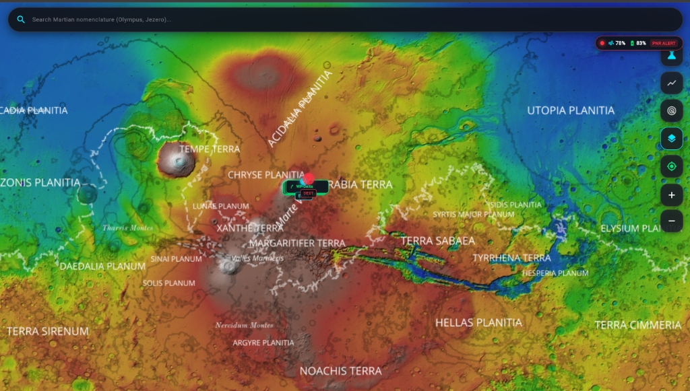
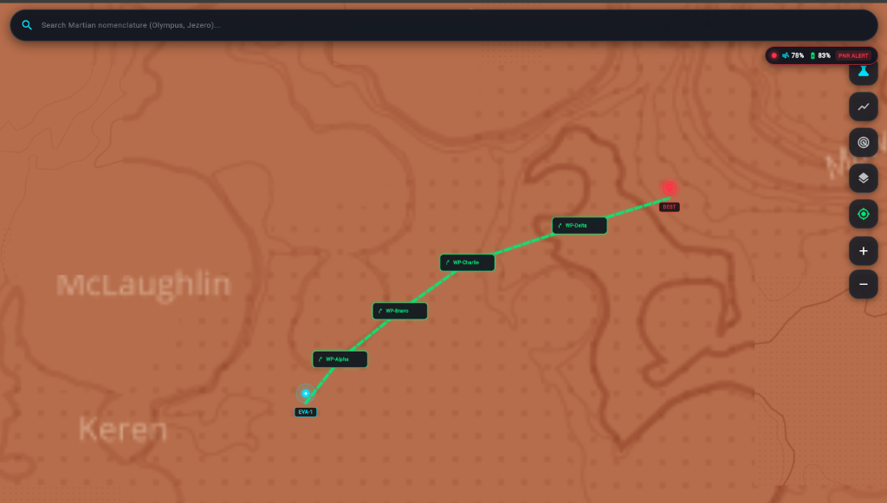
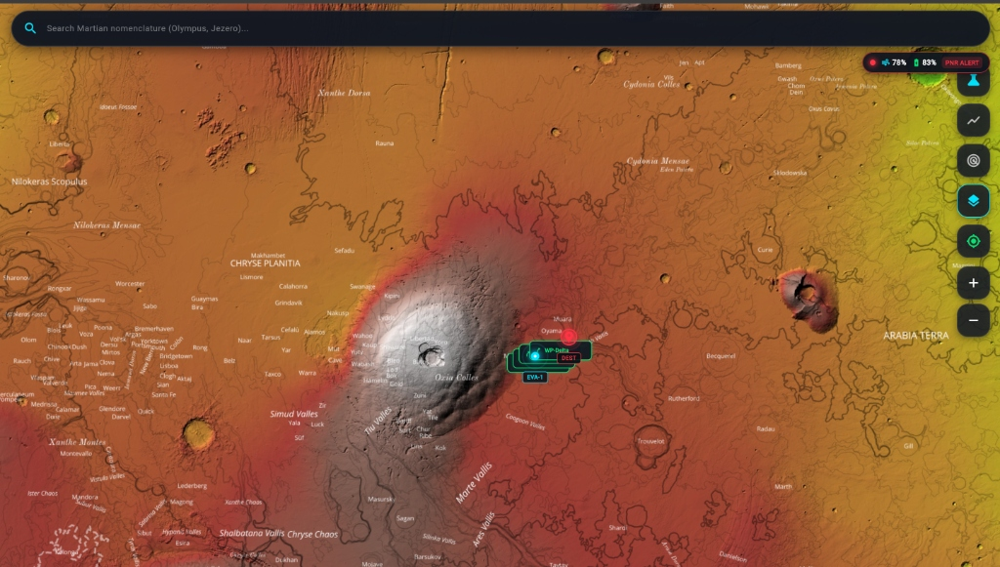
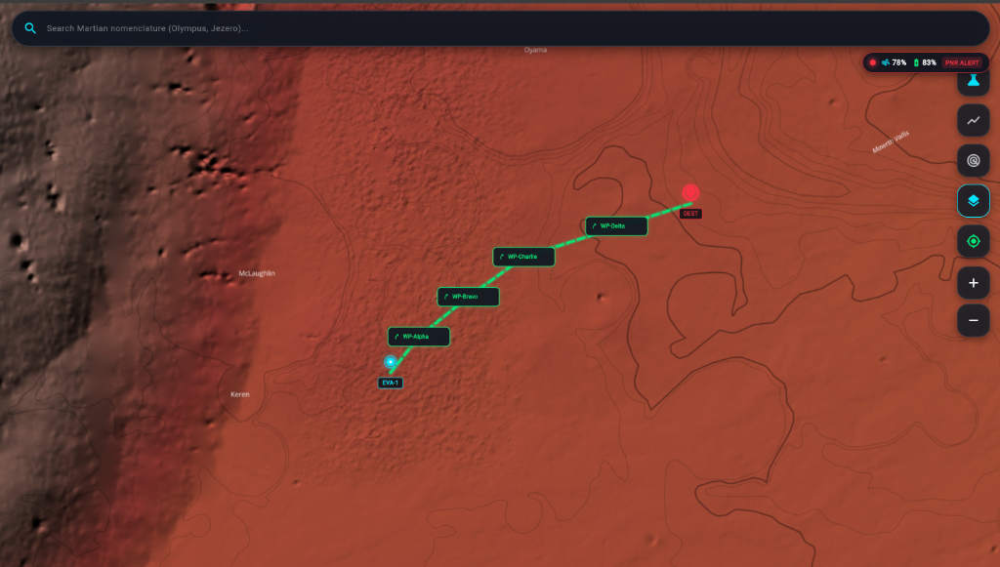
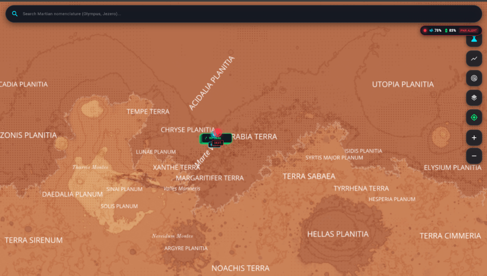
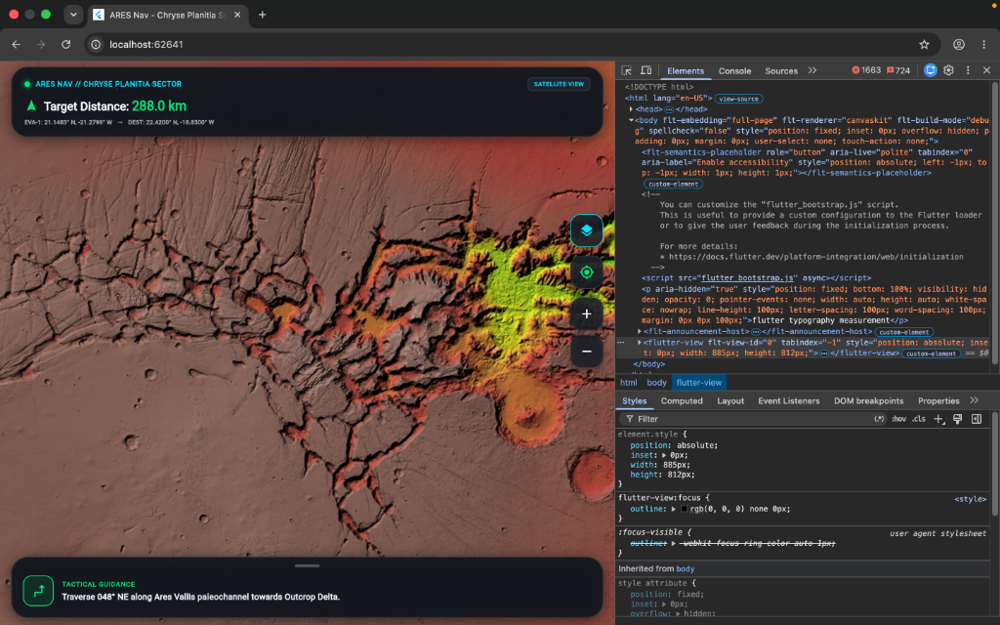
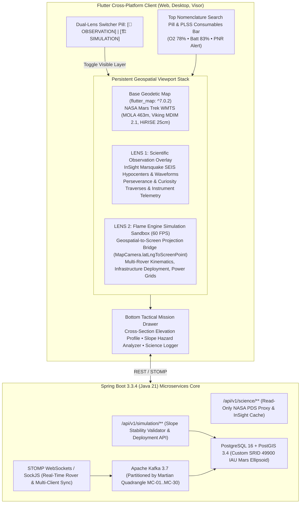

<div align="center">

# 🔴 ARES Nav — Astronaut Real-Time Exploration & Safety System
### *The Open-Source Geodetic GIS & In-Situ Tactical Navigation Engine for Mars*

[](https://www.spaceappschallenge.org/)
[](https://flutter.dev)
[](https://flame-engine.org)
[](https://spring.io/projects/spring-boot)
[](https://postgis.net)
[](https://kafka.apache.org)
[](LICENSE)
[](CONTRIBUTING.md)

<br/>

**ARES Nav** is an open-source, production-grade Martian Geographic Information System (GIS) and autonomous surface navigation platform designed to become **the most sophisticated, scientifically accurate, and high-performance map of Mars ever built**. 

Built for crewed interplanetary surface expeditions, autonomous multi-rover fleets, and planetary surface science, ARES Nav combines **NASA Planetary Data System (PDS) orbital rasters**, **MOLA areoid elevation geodesy**, **Spring Boot microservices**, **PostGIS spatial geometry**, and an interactive **Flame 2D/2.5D simulation loop** seamlessly running over `flutter_map`.

[Explore the Map](#-planetary-interface-showcase) • [Why Mars GIS is Different](#-the-geodetic-challenge-why-earth-gis-fails-on-mars) • [Dual-Lens Architecture](#-the-dual-lens-architectural-paradigm) • [150 Engineering Issues](#-open-source-roadmap--150-advanced-issues) • [Quickstart](#-quickstart--local-deployment) • [Contributing](#-why-contribute--how-to-join)

</div>

---

## 📸 Planetary Interface Showcase

ARES Nav renders multi-gigabyte Martian orbital mosaics, hypsometric elevation gradients, and real-time kinodynamic navigation paths at 60 FPS.

### 1. Global Hypsometry & Topographic Elevation
<div align="center">
  
  <p align="center">
    <b>Figure 1: Full-Spectrum MOLA Hypsometric Elevation Model</b><br/>
    <i>Continuous topographic elevation scale spanning from the depths of Hellas Planitia (blue, -8,200m) through the datum plains of Chryse and Utopia (green/yellow, -2,000m to 0m) to the volcanic summits of Tharsis Montes and Olympus Mons (white, +21,287m).</i>
  </p>
</div>

---

### 2. Autonomous Tactical Surface Traversal & PNR Safety Tracking
<div align="center">
  
  <p align="center">
    <b>Figure 2: Tactical Waypoint Traversal & Real-Time Life Support Telemetry</b><br/>
    <i>Kinodynamic route from EVA-1 through intermediate waypoints (WP-Alpha, WP-Bravo, WP-Charlie, WP-Delta) to Destination. Top HUD shows real-time Primary Life Support System (PLSS) telemetry: <b>O₂ Tank 78%</b>, <b>Suit Battery 83%</b>, and automated <b>Point of No Return (PNR) Safety Horizon Alert</b>.</i>
  </p>
</div>

---

### 3. Catastrophic Outflow Channels & Regional Micro-Relief
<div align="center">
  <table>
    <tr>
      <td width="50%">
        
        <p align="center">
          <b>Figure 3: Catastrophic Outflow Channels</b><br/>
          <i>High-contrast relief of Simud, Tiu, and Ares Vallis paleochannels debouching into Chryse Planitia with streamlined teardrop islands.</i>
        </p>
      </td>
      <td width="50%">
        
        <p align="center">
          <b>Figure 4: Micro-Relief Shading & Topographic Contours</b><br/>
          <i>HiRISE 25cm/pixel stereo relief with real-time vector contour intervals and crater rim shadow projection around Oyama and McLaughlin.</i>
        </p>
      </td>
    </tr>
    <tr>
      <td width="50%">
        
        <p align="center">
          <b>Figure 5: IAU Planetary Nomenclature Gazetteer</b><br/>
          <i>Dynamic label decluttering and spatial collision filtering covering major quadrangles (Tempe Terra, Arabia Terra, Hellas, Noachis, Tharsis).</i>
        </p>
      </td>
      <td width="50%">
        
        <p align="center">
          <b>Figure 6: Valles Marineris Canyon Fault Lines</b><br/>
          <i>Chasmata fault lines with real-time slope hazard identification (>25° unstable scree slopes flagged in neon amber/red).</i>
        </p>
      </td>
    </tr>
  </table>
</div>

---

## 🌌 The Geodetic Challenge: Why Earth GIS Fails on Mars

Every off-the-shelf terrestrial mapping library (Google Maps, Mapbox, Leaflet, OpenStreetMap) makes foundational mathematical assumptions that are fundamentally invalid on Mars:

```
┌──────────────────────────────────────────────────────────────────────────────┐
│ TERRESTRIAL GIS (Earth)              │ ARES NAV MARTIAN GIS (Mars)          │
├──────────────────────────────────────┼──────────────────────────────────────┤
│ WGS-84 Oblate Spheroid               │ IAU 2000 Mars Triaxial Ellipsoid     │
│ (Ra = 6,378,137m, f = 1/298.257)     │ (Ra = 3,396,190m, c = 3,376,200m)    │
├──────────────────────────────────────┼──────────────────────────────────────┤
│ Mean Sea Level (MSL) Vertical Datum  │ MOLA Gravitational Areoid Equipotential│
│ (Defined by physical liquid oceans)  │ (Derived from MGS GMM-3 Doppler math)│
├──────────────────────────────────────┼──────────────────────────────────────┤
│ Global Dipole Magnetic Field         │ Zero Global Dipole; Intense Local    │
│ (Reliable magnetic compass needle)   │ Remanent Crustal Fields (±1500 nT)   │
├──────────────────────────────────────┼──────────────────────────────────────┤
│ 10 Hz Real-Time Satellite GPS Const. │ Zero GPS Constellation; Autonomous   │
│ (Direct ephemeris positioning)       │ Visual Odometry + IMU Dead Reckoning │
├──────────────────────────────────────┼──────────────────────────────────────┤
│ 15 ms Cloud Round-Trip Latency       │ 3.1 to 22.2 Minute Interplanetary    │
│ (Centralized backend pathfinding)    │ Light-Time Delay (Autonomous Edge)   │
└──────────────────────────────────────────────────────────────────────────────┘
```

**ARES Nav is engineered from the ground up to solve these extraterrestrial physics.**

---

## 🔬 The "Dual-Lens" Architectural Paradigm

ARES Nav solves the challenge of uniting deep scientific planetary research with real-time multi-agent simulation through a persistent geodetic viewport that **never tears or resets the underlying tile cache**:



---

## 🛠️ Complete Technical Stack Matrix

```
┌────────────────────────────────────────────────────────────────────────────┐
│ FRONTEND (Flutter & Flame Engine)                                          │
├────────────────────────────────────────────────────────────────────────────┤
│ • Framework:        Flutter 3.24+ (Dart 3.5, Material 3 Dark HUD)          │
│ • Geodetic Map:     flutter_map ^7.0.2 & latlong2 (IAU 2000 Mars Spheroid) │
│ • Game/Sim Engine:  Flame 1.38+ (60 FPS GameLoop, Hitboxes, Particles)     │
│ • Networking:       web_socket_channel, stomp_dart_client, http 1.6        │
│ • Styling:          Custom glassmorphism (BackdropFilter 14px blur)        │
├────────────────────────────────────────────────────────────────────────────┤
│ BACKEND (Spring Boot & Spatial Infrastructure)                             │
├────────────────────────────────────────────────────────────────────────────┤
│ • Microservice:     Spring Boot 3.3.4 (Java 21 LTS, Virtual Threads/Loom)  │
│ • Spatial Engine:   Hibernate Spatial 6.5, JTS Core 1.19, Jackson-JTS      │
│ • Database:         PostgreSQL 16 with PostGIS 3.4 (Spatial GiST Indexing) │
│ • Event Broker:     Apache Kafka 3.7 (KRaft Mode, Quadrangle Partitioning) │
│ • WebSocket Server: Spring WebSocket + STOMP over SockJS (/ws-mars)        │
│ • Reactive Client:  Spring WebFlux / WebClient (Non-blocking PDS Proxy)    │
│ • Containerization: Docker & Docker Compose v2.20+                         │
└────────────────────────────────────────────────────────────────────────────┘
```

---

## ⚡ Quickstart & Local Deployment

### 1. Clone the Monorepo
```bash
git clone https://github.com/YeamimHossainSajid/ARES-Nav.git
cd ARES-Nav
```

### 2. Launch PostGIS Spatial Database & Apache Kafka
```bash
docker compose up -d postgis kafka
```
*Verify PostGIS spatial extension status:*
```bash
docker exec -it mars_postgis psql -U ares_admin -d mars_mission_db -c "SELECT PostGIS_Full_Version();"
```

### 3. Start the Spring Boot Backend Server
```bash
cd backend
./gradlew bootRun
```
*Backend endpoints and STOMP WebSocket server will start on `http://localhost:8080`.*

### 4. Run the Flutter Frontend in Google Chrome
```bash
cd ../frontend
flutter pub get
flutter run -d chrome
```

---

## 🌟 Why Contribute? Be Part of the Best Mars Map Ever Built

Most open-source mapping projects are clones of terrestrial tools. **ARES Nav is different**: we are building the operational navigation software that future Mars astronauts, roboticists, and planetary scientists will actually rely on.

### What Makes Contributing to ARES Nav Unique:
1. **Real NASA/ESA Data:** You work directly with genuine orbital telemetry from MRO HiRISE ($0.25\text{ m/px}$), Mars Global Surveyor MOLA, Mars Express HRSC, and InSight SEIS seismograms.
2. **Cutting-Edge Stack:** Modern Flutter 3.24 + Flame 2D game engine + Spring Boot 3 + PostGIS spatial geometry + Kafka event streaming.
3. **NASA Space Apps Challenge 2026:** ARES Nav is engineered to win, with rigorous scientific alignment and production-grade software craftsmanship.
4. **Structured for Immediate Impact:** We have pre-architected **150 production-grade issues** so you can pick an exact component, write code, and immediately see your contribution run on Mars!

👉 **[Browse the Master 150 Issues in `docs/ISSUES.md`](docs/ISSUES.md)**

---

## 🗺️ The 150 High-Level Issues Breakdown

The 150 engineering issues are organized across 10 specialized planetary domains:

```
[Domain 1: Planetary Geodesy & Projections] ────────► Issues #001 - #015
  IAU 2000 Ellipsoid, MOLA Areoid Undulations, LTP/NED Frames, EKF Dead Reckoning

[Domain 2: Orbital Imagery & HiRISE DTM Tiling] ────► Issues #016 - #030
  HiRISE 25cm DTM Pipelines, WebGL Dynamic Hillshading Shaders, Sparse Quadtree Caches

[Domain 3: Slope Stability & Geotechnical Hazards] ─► Issues #031 - #045
  3x3 Sobel Gradient Kernel, Terzaghi Bearing Capacity, Scree Avalanche Triggers (>25°)

[Domain 4: Surface Pathfinding & Kinodynamics] ─────► Issues #046 - #060
  3D Kinodynamic Field D*, Solar Transit Energy-Positive Routing, PNR Bingo Envelopes

[Domain 5: Flame Engine & Viewport Bridge] ─────────► Issues #061 - #075
  latLngToScreenPoint Bridge at 60 FPS, MOLA Z-Buffer Depth Sorting, Rocker-Bogie Physics

[Domain 6: In-Situ Resource Utilization (ISRU)] ────► Issues #076 - #090
  SHARAD Water-Ice Extraction Yields, Sabatier Propellant Synthesis, ECLSS Mass Balance

[Domain 7: Distributed Backend & PostGIS 16] ───────► Issues #091 - #105
  Custom SRID 49900 Mars CRS, GiST Spatial Index Tuning, PostGIS Raster Elevation Profiles

[Domain 8: Real-Time Telemetry & STOMP / Kafka] ────► Issues #106 - #120
  Binary Protobuf WebSockets, Kafka Quadrangle Partitioning, Delay-Tolerant Networking

[Domain 9: Astrobiological Field Notebook & AI] ────► Issues #121 - #135
  Raman Spectral Unmixing, Biosignature Preservation Potential, 3D Core Reconstructor

[Domain 10: Tactical Safety HUD & PLSS Telemetry] ──► Issues #136 - #150
  PLSS Metabolic Depletion Forecaster, Cosmic Radiation Dosimeter, Autonomous Rescue Dispatch
```

---

## 🤝 How to Join & Contribute

1. Check out our **[Contributing Guidelines](CONTRIBUTING.md)** and **[Code of Conduct](CODE_OF_CONDUCT.md)**.
2. Select an unassigned issue from the **[150 Issues Roadmap](docs/ISSUES.md)** or open a new one using the **[Advanced Engineering Template](.github/ISSUE_TEMPLATE/engineering_issue.yml)**.
3. Fork the repository and create your feature branch:
   ```bash
   git checkout -b feature/issue-061-flame-geospatial-bridge
   ```
4. Run tests and static analysis:
   ```bash
   cd frontend && flutter analyze && flutter test
   cd ../backend && ./gradlew test
   ```
5. Submit your Pull Request referencing the Issue ID!

---

## 📜 Scientific References & Planetary Datasets

1. **Smith, D. E., et al.** (2001). *Mars Orbiter Laser Altimeter: Experiment overview and surface topography*. Journal of Geophysical Research: Planets, 106(E10), 23689-23722.
2. **Archinal, B. A., et al.** (2018). *Report of the IAU/IAG Working Group on Cartographic Coordinates and Rotational Elements: 2015*. Celestial Mechanics and Dynamical Astronomy, 130(3), 22.
3. **Banerdt, W. B., et al.** (2020). *Initial results from the InSight mission on Mars*. Nature Geoscience, 13(3), 183-189.
4. **Farley, K. A., et al.** (2020). *Mars 2020 Mission Overview*. Space Science Reviews, 216(8), 142.
5. **McEwen, A. S., et al.** (2007). *Mars Reconnaissance Orbiter's High Resolution Imaging Science Experiment (HiRISE)*. Journal of Geophysical Research: Planets, 112(E5).

---

<div align="center">
  <b>Developed for humanity's multiplanetary future • Built for the NASA Space Apps Challenge</b><br/>
  <i>"Ad Astra Per Aspera — Through hardships to the stars."</i>
</div>
