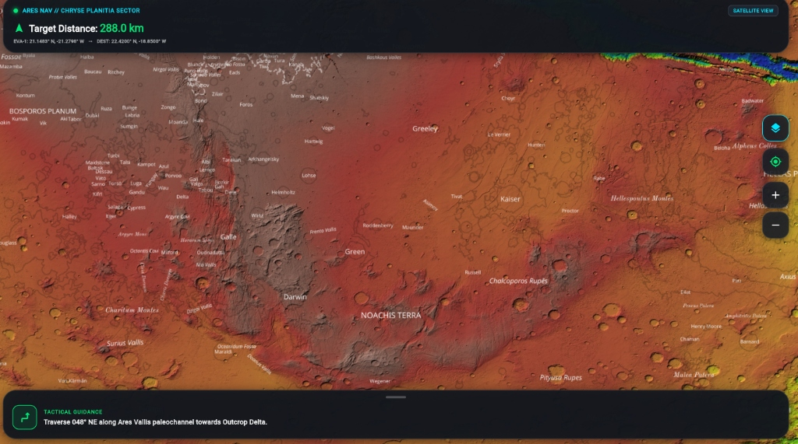
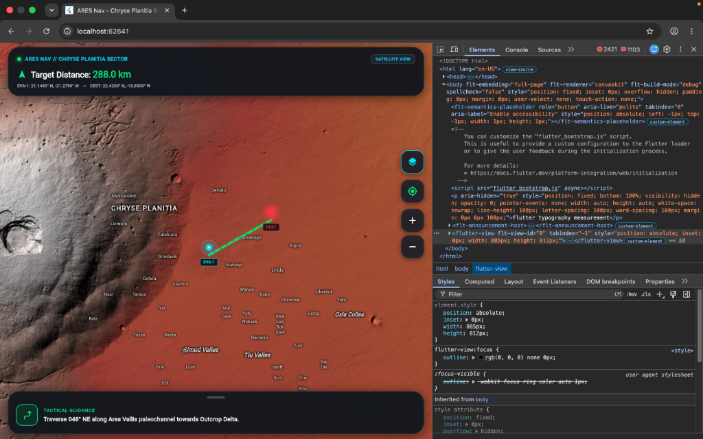
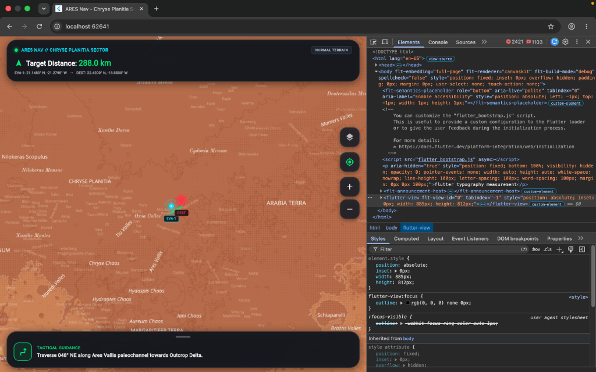

<div align="center">

# 🔴 ARES Nav — Astronaut Real-Time Exploration & Safety System
### *The Open-Source Geodetic GIS & In-Situ Tactical Navigation Engine for Mars*

[](https://www.spaceappschallenge.org/)
[](https://flutter.dev)
[](https://flame-engine.org)
[](https://spring.io/projects/spring-boot)
[](https://postgis.net)
[](https://kafka.apache.org)
[](LICENSE)

<br/>

**ARES Nav** is a mission-grade, open-source Martian Geographic Information System (GIS) and autonomous tactical navigation platform. Engineered specifically for crewed planetary surface excursions, autonomous rover fleets, and ground habitat operations, it bridges the gap between **scientific planetary telemetry (NASA PDS, USGS Astrogeology)** and **real-time interactive multi-agent simulation**.

[Explore Live Map](#-interactive-interface-preview) • [Dual-Lens Architecture](#-the-dual-lens-architectural-paradigm) • [150 Engineering Issues](#-open-source-roadmap--150-advanced-issues) • [Quickstart](#-quickstart--local-deployment) • [Contributing](#-contributing)

</div>

---

## 📸 Interactive Interface Preview

ARES Nav renders multi-gigabyte Martian orbital rasters, MOLA topography, and real-time pathfinding vectors directly within a responsive Flutter HUD.

<div align="center">
  <table>
    <tr>
      <td width="50%">
        
        <p align="center"><b>Figure 1: Global MOLA Topographic Elevation (Noachis Terra to Hellas Basin)</b><br/><i>Continuous color-ramp elevation shaded relief relative to the Martian Areoid datum (-2,500m to +8,000m).</i></p>
      </td>
      <td width="50%">
        
        <p align="center"><b>Figure 2: Chryse Planitia Tactical Sector (288.0 km Traverse)</b><br/><i>Active pathfinding vector from EVA-1 beacon to Target Outcrop Delta with topographic placenames.</i></p>
      </td>
    </tr>
    <tr>
      <td width="50%">
        
        <p align="center"><b>Figure 3: Valles Marineris Canyon System & Slope Gradients</b><br/><i>Chasmata fault lines with real-time slope hazard identification (>25° scree slope detection).</i></p>
      </td>
      <td width="50%">
        
        <p align="center"><b>Figure 4: Cartographic Base Layer & Paleochannel Guidance</b><br/><i>Tactical guidance drawer instructing EVA traversal along the Ares Vallis ancient riverbed.</i></p>
      </td>
    </tr>
  </table>
</div>

---

## 🌌 The Fundamental Geodetic Challenge: Why Earth GIS Fails on Mars

Standard mapping engines (Google Maps, Mapbox, OpenStreetMap) are fundamentally bound to terrestrial geodetics:
1. **The Ellipsoid:** Earth GIS assumes the WGS-84 oblate spheroid ($R_a = 6,378,137\text{ m}$, $f = 1/298.257$). Mars is a triaxial ellipsoid defined under the **IAU 2000 Cartographic Standard** with a mean radius of $R = 3,396,190\text{ m}$.
2. **The Vertical Datum:** Earth elevation is measured from Mean Sea Level (MSL). Mars possesses no oceans; elevation is strictly computed from the **MOLA Gravitational Areoid**—an equipotential gravitational surface derived from Mars Global Surveyor radio tracking.
3. **The Absence of a Global Dipole:** Earth navigators rely on magnetic compasses. Mars has **zero global magnetic dipole**, possessing only intense localized crustal remanent magnetic fields that spin conventional compasses erratically.
4. **Communication Latency:** Terrestrial GPS updates at 10 Hz. Earth-to-Mars light-time latency ranges from **3.1 to 22.2 minutes**, rendering centralized cloud routing impossible. All navigation, slope stability verification, and hazard avoidance must run **fully autonomous on the edge**.

**ARES Nav is engineered from scratch for these extraterrestrial physics.**

---

## 🔬 The "Dual-Lens" Architectural Paradigm

ARES Nav solves the dual requirement of deep scientific planetary research and gamified mission operations through a persistent geodetic viewport that never destroys the underlying tile cache.

```
┌────────────────────────────────────────────────────────────────────────┐
│                        Flutter UI Shell & HUD                          │
│     [Top Search Pill]  [Dual-Lens Switcher Pill]  [Layer Selector Deck] │
├────────────────────────────────────────────────────────────────────────┤
│                           Flutter Stack                                │
│  ┌──────────────────────────────────────────────────────────────────┐  │
│  │ LENS 2: Flame Engine Simulation Sandbox (Overlaid Game Loop)      │  │
│  │ - 60 FPS Canvas-to-Geographic Projection Synchronization         │  │
│  │ - Mobile Rover Kinematics, Infrastructure Hitboxes, Resource Net │  │
│  └─────────────────────────────────▲────────────────────────────────┘  │
│  ┌─────────────────────────────────┼────────────────────────────────┐  │
│  │ LENS 1: Scientific Observation Layer                             │  │
│  │ - InSight Marsquake SEIS Hypocenters & Waveform Telemetry        │  │
│  │ - Mars 2020 Perseverance & MSL Curiosity Traverse Tracks        │  │
│  └─────────────────────────────────▲────────────────────────────────┘  │
│  ┌─────────────────────────────────┼────────────────────────────────┐  │
│  │ BASE MAP: flutter_map Geodetic Core                              │  │
│  │ - NASA Mars Trek / USGS Web Map Tile Service (WMTS) Engine       │  │
│  │ - MOLA 463m Elevation | Viking MDIM 2.1 | HiRISE 25cm/px Jezero  │  │
│  │ - Coordinate Grid Overlay (IAU 2000 Mars System)                 │  │
│  └──────────────────────────────────────────────────────────────────┘  │
└────────────────────────────────────────────────────────────────────────┘
                                    │  STOMP WebSockets / REST
                                    ▼
┌────────────────────────────────────────────────────────────────────────┐
│             Spring Boot 3.3.4 (Java 21) Microservices Core             │
│  ┌──────────────────────────────┐    ┌──────────────────────────────┐  │
│  │  /api/v1/science/**          │    │  /api/v1/simulation/**       │  │
│  │  - NASA PDS & InSight Cache  │    │  - Terrain Slope Validator   │  │
│  │  - USGS WMTS Proxy Service   │    │  - Infrastructure Deployment │  │
│  └──────────────┬───────────────┘    └──────────────┬───────────────┘  │
│                 │                                   │                  │
│                 ▼                                   ▼                  │
│       PostgreSQL 16 + PostGIS              Apache Kafka 3.7            │
│   (Spatial GiST Index, SRID 49900)      (State Broadcast Bus)          │
└────────────────────────────────────────────────────────────────────────┘
```

### Lens 1: Scientific Observation Mode
- **Real Planetary Data:** Zero synthetic datasets. Streams live from NASA Planetary Data System (PDS) and USGS Astrogeology servers.
- **Orbital Rasters:**
  - **MOLA Color-Shaded Topography:** 463 meters/pixel global elevation map.
  - **Viking MDIM 2.1 Mosaic:** True-color visible photographic surface.
  - **HiRISE Jezero Crater Mosaic:** 25 centimeters/pixel surface resolution revealing sedimentary fan channels and rover wheel tracks.
- **InSight Marsquake SEIS Catalog:** Interactive seismic markers displaying event magnitude ($M1.5 - M4.7$), Sol timestamp, focal depth, and tectonic origin (e.g., Cerberus Fossae grabens).
- **Surface Fleet Telemetry:** Historic and active rover telemetry (Perseverance, Curiosity) with PIXL, SHERLOC, Mastcam-Z, and MEDA instrument logs.

### Lens 2: In-Situ Simulation Mode
- **Interactive Sandbox:** Activates a Flutter `Flame` game loop running transparently above the geodetic map.
- **Geographic-to-Screen Projection Bridge:** All virtual entities (Habitat Domes, Solar Arrays, Pressurized Rovers) hold canonical $\text{LatLng}$ coordinates. When the user pans, zooms, or tilts the map, the bridge projects them to screen space in real time:
  $$\vec{P}_{\text{canvas}} = \text{MapCamera}.\text{latLngToScreenPoint}(\vec{L}_{\text{Mars}})$$
- **Server-Side Incline Slope Validation:** When a user attempts to deploy infrastructure, the Spring Boot backend queries high-resolution MOLA elevation rasters. If the local terrain slope gradient exceeds $\mathbf{12.0^\circ}$, deployment is rejected with geotechnical hazard alerts.

---

## 🏛️ Technical Stack

| Tier | Technology | Purpose |
| :--- | :--- | :--- |
| **Mobile & Web Client** | **Flutter 3.24+ (Dart 3.5)** | Cross-platform mission HUD running on Chrome, macOS, iPad, and Android. |
| **Geospatial Map Engine** | **`flutter_map: ^7.0.2` & `latlong2`** | High-performance raster tile rendering, custom spherical projections. |
| **Simulation Engine** | **`flame: ^1.38.2`** | 60 FPS game loop, collision hitboxes, sprite rendering, kinematic pathing. |
| **Backend Framework** | **Spring Boot 3.3.4 (Java 21)** | Enterprise reactive microservices, virtual threads (Project Loom), REST APIs. |
| **Spatial Database** | **PostgreSQL 16 + PostGIS 3.4** | Non-terrestrial spatial queries, GiST geometry indexing (`Point`, `Polygon`). |
| **Real-Time Messaging** | **Spring WebSocket + STOMP / SockJS** | Multi-client multiplayer state streaming and low-latency rover position sync. |
| **Event Broker** | **Apache Kafka 3.7 (KRaft mode)** | High-throughput distributed telemetry ingest from edge rovers and orbiters. |
| **Containerization** | **Docker & Docker Compose** | Reproducible multi-service deployment with single-command spin-up. |

---

## 📂 Monorepo Architecture

```
mars_mission_monorepo/
├── .github/
│   ├── ISSUE_TEMPLATE/        # Standardized issue templates
│   └── workflows/ci.yml       # Automated CI/CD pipeline (JDK 21 & Flutter)
├── docker-compose.yml         # Containerized PostGIS 16 & Apache Kafka setup
├── docs/
│   ├── images/                # High-res screenshots and architectural diagrams
│   └── ISSUES.md              # The Master 150 High-Level Issue Roadmap
├── backend/                   # Spring Boot 3.3.4 (Java 21) Microservice
│   ├── build.gradle           # Hibernate Spatial 6, JTS Core, Kafka, WebFlux
│   └── src/main/
│       ├── java/gov/nasa/ares/
│       │   ├── AresBackendApplication.java
│       │   ├── config/        # WebSocket STOMP, PostGIS Dialect, Jackson JTS
│       │   ├── science/       # Read-only NASA PDS & InSight telemetry proxies
│       │   ├── simulation/    # Slope validation service, deployment controllers
│       │   └── websocket/     # STOMP broker event publishers
│       └── resources/
│           ├── application.yml# Database, NASA WMTS URLs, slope thresholds
│           └── db/init.sql    # PostGIS table definitions & spatial GiST indexes
└── frontend/                  # Flutter 3.x Cross-Platform Client
    ├── pubspec.yaml           # flutter_map 7.0.2, flame 1.38.2, latlong2
    ├── assets/                # Tactical HUD assets & Flame sprites
    └── lib/
        ├── main.dart          # Entry point & DualLensMainScreen coordinator
        ├── core/              # LensStateController, MartianCoordinate geodetics
        ├── map/               # MarsBaseMap, NASA WMTS tile catalog (MOLA/HiRISE)
        ├── observation/       # ScienceLayer, InSight Marsquakes, Percy telemetry
        ├── simulation/        # MarsSimulationGame, Flame projection bridge
        └── ui/                # DualLensHeader, MissionDrawer, FieldNotebook
```

---

## ⚡ Quickstart & Local Deployment

### 1. Prerequisites
- **Git**
- **Docker & Docker Compose** (v2.20+)
- **JDK 21** (e.g., Eclipse Temurin 21)
- **Flutter SDK** (3.20.0 or higher)

### 2. Clone Repository
```bash
git clone https://github.com/YeamimHossainSajid/ARES-Nav.git
cd ARES-Nav
```

### 3. Start Spatial Database & Messaging Infrastructure
```bash
docker compose up -d postgis kafka
```
*Verify PostGIS spatial extension is ready:*
```bash
docker exec -it mars_postgis psql -U ares_admin -d mars_mission_db -c "SELECT PostGIS_Full_Version();"
```

### 4. Launch Spring Boot Backend
```bash
cd backend
./gradlew bootRun
```
*The REST API and STOMP WebSocket server will initialize at `http://localhost:8080`.*

### 5. Launch Flutter Frontend in Google Chrome
```bash
cd ../frontend
flutter pub get
flutter run -d chrome
```

---

## 🛰️ NASA Web Map Tile Service (WMTS) Integration

ARES Nav directly connects to planetary tile services hosted by NASA Jet Propulsion Laboratory (JPL) and the United States Geological Survey (USGS) Astrogeology Science Center:

```dart
// Example NASA Trek WMTS Layer Integration (flutter_map)
TileLayer(
  urlTemplate: 'https://trek.nasa.gov/tiles/Mars/EQ/Mars_MGS_MOLA_ClrShade_merge_global_463m/1.0.0//default/default028mm/{z}/{y}/{x}.jpg',
  userAgentPackageName: 'gov.nasa.ares.mars_nav',
  minZoom: 1.0,
  maxZoom: 9.0,
  tileProvider: NetworkTileProvider(),
)
```

---

## 🗺️ Open-Source Roadmap & 150 Advanced Issues

We are committed to building **the definitive, most sophisticated Martian mapping platform on Earth**. To enable senior aerospace engineers, geophysicists, graphics programmers, and distributed systems architects to contribute immediately, we have cataloged **150 production-grade issues** across 10 specialized engineering domains.

👉 **[Read the Full 150-Issue Technical Specification in ISSUES.md](docs/ISSUES.md)**

### Summary of Domains:
1. **Planetary Geodesy & Non-Terrestrial Projections** (`#001` - `#015`): IAU 2000 ellipsoid calculations, MOLA Areoid geoid undulations, triaxial coordinate transformations.
2. **Orbital Raster Pipeline & HiRISE DTM Streaming** (`#016` - `#030`): 25cm/px stereo photogrammetry, HRSC terrain relief, dynamic WebGL hillshading shaders.
3. **Geotechnical Terrain Slope & Hazard Solvers** (`#031` - `#045`): 3x3 Sobel slope gradient engines, TES regolith bearing capacity, scree avalanche modeling.
4. **Autonomous Surface Pathfinding & Kinodynamics** (`#046` - `#060`): 3D Field D* algorithm with rover wheel slip, solar energy transit optimization, canyon line-of-sight relays.
5. **Flame Engine Simulation & Viewport Bridge** (`#061` - `#075`): 60 FPS sub-pixel geospatial synchronization, MOLA z-buffer depth sorting, dust devil particle physics.
6. **In-Situ Resource Utilization (ISRU) Systems** (`#076` - `#090`): SHARAD radar permafrost water-ice extraction yields, Sabatier reactor models, photovoltaic dust attenuation.
7. **Distributed Spatial Backend & PostGIS 16** (`#091` - `#105`): Custom SRID 49900 Mars spatial functions, R-tree GiST indexing, transactional deployment isolation.
8. **Real-Time Telemetry & Delay-Tolerant Networking** (`#106` - `#120`): Low-latency STOMP/Protobuf streaming, Kafka Quadrangle partitioning, DTN bundle protocol for solar conjunctions.
9. **Astrobiological Field Notebook & Spectral AI** (`#121` - `#135`): CRISM/SuperCam Raman mineral deconvolution, Biosignature Preservation Potential (BPP) rating algorithms.
10. **Astronaut Tactical Safety HUD & PLSS Telemetry** (`#136` - `#150`): Consumable metabolic depletion forecasting, cosmic radiation dosimeter alerts, autonomous rescue dispatch vectors.

---

## 🤝 Contributing

We welcome contributions from planetary scientists, aerospace software architects, Flutter engineers, and game engine developers.

1. Review the [Code of Conduct](CODE_OF_CONDUCT.md).
2. Browse the [150 Open Issues](docs/ISSUES.md) and assign yourself to an issue.
3. Fork the repository and create your feature branch:
   ```bash
   git checkout -b feature/issue-046-kinodynamic-field-dstar
   ```
4. Ensure all tests and static analysis pass:
   ```bash
   cd frontend && flutter analyze && flutter test
   cd ../backend && ./gradlew test
   ```
5. Submit a descriptive Pull Request referencing the Issue number.

---

## 📜 Scientific References & Citations

1. **Smith, D. E., et al.** (2001). *Mars Orbiter Laser Altimeter: Experiment overview and surface topography*. Journal of Geophysical Research: Planets, 106(E10), 23689-23722.
2. **Archinal, B. A., et al.** (2018). *Report of the IAU/IAG Working Group on Cartographic Coordinates and Rotational Elements: 2015*. Celestial Mechanics and Dynamical Astronomy, 130(3), 22.
3. **Banerdt, W. B., et al.** (2020). *Initial results from the InSight mission on Mars*. Nature Geoscience, 13(3), 183-189.
4. **Farley, K. A., et al.** (2020). *Mars 2020 Mission Overview*. Space Science Reviews, 216(8), 142.

---

<div align="center">
  <b>Developed for humanity's multiplanetary future • Built for the NASA Space Apps Challenge</b><br/>
  <i>"Ad Astra Per Aspera — Through hardships to the stars."</i>
</div>
